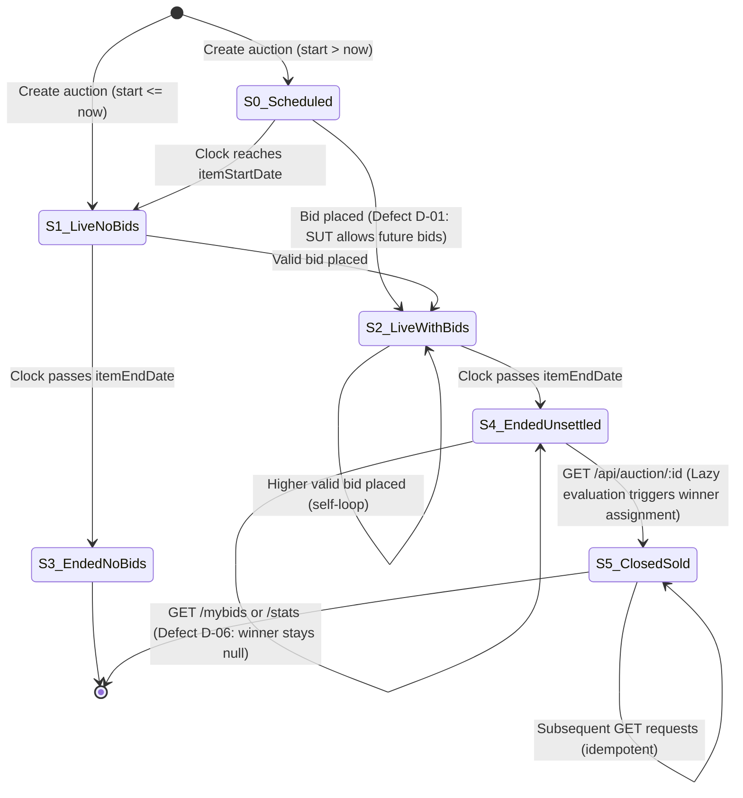

# State Transition (ST) Test Design

**System Under Test:** `theavnishkumar/online-auction-system` (`ecd4de475fdf49d54153ffaa57d42b392161007a`)  
**Document Reference:** `02_Test_Case_Design/4_State_Transition.md`  
**Technique:** State machine modeling, transition testing, and invalid transition matrix.

---

## 1. Overview of State Transition Testing

State Transition testing evaluates system behavior across the lifecycle of an entity whose responses differ depending on its current state and previous history. For the Online Auction System, the central stateful entity is the **Auction (`Product`)**.

---

## 2. State Machine Specification

### 2.1 State Definitions
- **$S_0$ Scheduled:** Auction created with `itemStartDate > now`.
- **$S_1$ Live (No Bids):** `itemStartDate <= now < itemEndDate` and `bids.length === 0`.
- **$S_2$ Live (With Bids):** `itemStartDate <= now < itemEndDate` and `bids.length > 0`. `currentPrice` tracks the highest bid.
- **$S_3$ Ended (Unsold / No Bids):** `now >= itemEndDate` and `bids.length === 0`.
- **$S_4$ Ended (Unsettled):** `now >= itemEndDate` and `bids.length > 0`, but `winner === null` and `isSold === false`. *(Crucial intermediate state created by SUT's lazy evaluation architecture)*.
- **$S_5$ Closed / Sold:** `now >= itemEndDate`, `winner !== null`, and `isSold === true`.

---

## 3. State Transition Diagram

---

## 4. State Transition Table

| Current State | Trigger / Event | Guard Condition | Next State | Expected System Actions | SUT Defect Reference |
|---|---|---|---|---|---|
| **$S_0$ Scheduled** | Place Bid | $now < start$ | Stays $S_0$ | Should reject with 400 "Auction not yet started" | **`D-01` (SUT accepts bid and moves to $S_2$)** |
| **$S_1$ Live (No Bids)** | Place Valid Bid ($B+1 \le A \le B+10$) | $now < end$ | **$S_2$ Live (With Bids)** | `currentPrice = A`, `bids.push(bid)`, emit `bidPlaced` | Normal Transition |
| **$S_1$ Live (No Bids)** | Time Elapsed ($now \ge end$) | No bids placed | **$S_3$ Ended (No Bids)** | Expiration reached; bids blocked | Normal Transition |
| **$S_2$ Live (With Bids)** | Place Valid Bid ($A > B$) | $now < end$ | **$S_2$ Live (With Bids)** | Self-loop: `currentPrice` updated, new high bidder | Normal Transition |
| **$S_2$ Live (With Bids)** | Time Elapsed ($now \ge end$) | Bids present | **$S_4$ Ended (Unsettled)** | Auction ends; `winner` is still `null` in database | Normal Transition |
| **$S_4$ Ended (Unsettled)** | `GET /api/auction/:id` | Caller is seller or high bidder | **$S_5$ Closed / Sold** | Lazy resolution: writes `winner = bids[0].bidder`, `isSold = true` | Normal Transition |
| **$S_4$ Ended (Unsettled)** | `GET /api/auction/mybids` | High bidder views dashboard | Stays **$S_4$ Ended (Unsettled)** | SUT does not resolve winner on list queries; shows unresolved | **`D-06` (Unsettled auction on MyBids)** |
| **$S_5$ Closed / Sold** | Place Bid | Any amount | Stays **$S_5$ Closed / Sold** | Reject with 400 "Auction has already ended" | Normal Guard |

---

## 5. Invalid Transition Matrix

Testing invalid transitions ensures the system gracefully rejects illegal actions.

| From State \ Event | Place Bid ($now < start$) | Place Valid Bid | Place Low Bid ($A \le B$) | Place High Bid ($A > B+10$) | Time Elapses ($t > end$) | `GET /:id` |
|---|---|---|---|---|---|---|
| **$S_0$ Scheduled** | **Reject (Expected)** / Accepted (`D-01`) | Reject | Reject | Reject | N/A | Returns 200 (Scheduled) |
| **$S_1$ Live (No Bids)** | N/A | **Transition $\to S_2$** | Reject (400) | Reject (400) | **Transition $\to S_3$** | Returns 200 (Live) |
| **$S_2$ Live (With Bids)** | N/A | **Transition $\to S_2$** | Reject (400) | Reject (400) | **Transition $\to S_4$** | Returns 200 (Live) |
| **$S_3$ Ended (No Bids)** | Reject (400 Ended) | Reject (400 Ended) | Reject (400 Ended) | Reject (400 Ended) | N/A | Returns 200 (No winner) |
| **$S_4$ Ended (Unsettled)**| Reject (400 Ended) | Reject (400 Ended) | Reject (400 Ended) | Reject (400 Ended) | N/A | **Transition $\to S_5$** |
| **$S_5$ Closed / Sold** | Reject (400 Ended) | Reject (400 Ended) | Reject (400 Ended) | Reject (400 Ended) | N/A | Returns 200 (Sold) |

---

## 6. State Transition Test Case Mapping

| Test Case ID | Initial State | Trigger / Input | Target State | Expected Response / DB Verification |
|---|---|---|---|---|
| `TC-ST-001` | $S_1$ Live (No Bids) | Place first valid bid ($B+5$) | $S_2$ Live (With Bids) | 200 OK, `currentPrice = 105`, `bids.length = 1` |
| `TC-ST-002` | $S_2$ Live (With Bids) | Higher valid bid ($B+8$) | $S_2$ Live (With Bids) | 200 OK, `currentPrice = 113`, `bids.length = 2` |
| `TC-ST-003` | $S_2$ Live (With Bids) | Invalid bid below base ($B-2$) | Stays $S_2$ | 400 Bad Request, state & price unchanged |
| `TC-ST-004` | $S_1$ / $S_2$ | Clock reaches `itemEndDate` | $S_3$ / $S_4$ | Any subsequent bid rejected with 400 "Auction ended" |
| `TC-ST-005` | $S_4$ Ended (Unsettled) | `GET /api/auction/:id` | $S_5$ Closed / Sold | 200 OK, DB updated: `winner !== null`, `isSold === true` |
| `TC-ST-006` | $S_4$ Ended (Unsettled) | `GET /api/auction/mybids` | Stays $S_4$ | Demonstrates Defect `D-06` (unresolved winner) |
| `TC-ST-007` | $S_5$ Closed / Sold | Subsequent `GET /api/auction/:id` | Stays $S_5$ | 200 OK, idempotent, winner unchanged |
| `TC-ST-008` | $S_0$ Scheduled | Bid submitted before `itemStartDate` | Stays $S_0$ (Expected) | Demonstrates Defect `D-01` (bid prematurely accepted) |
